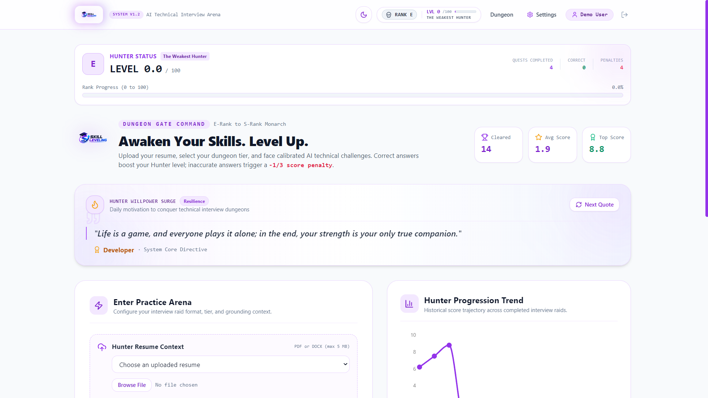
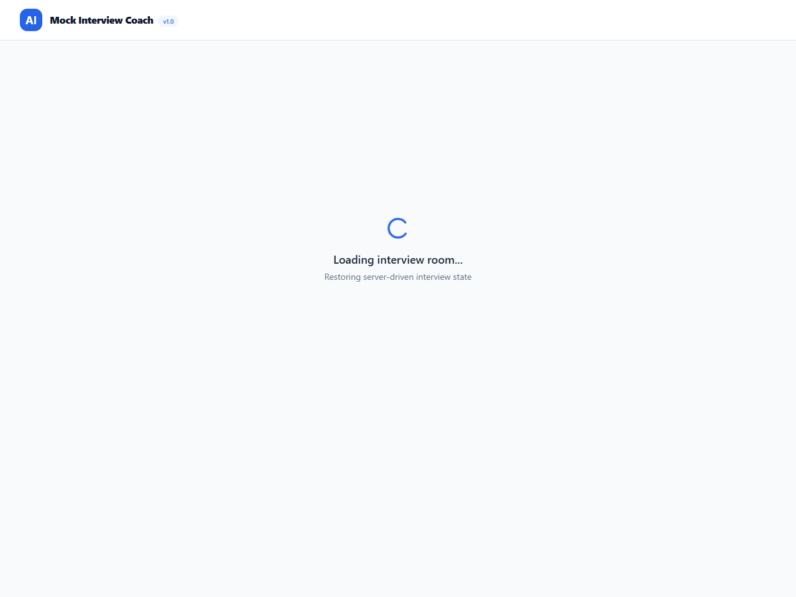
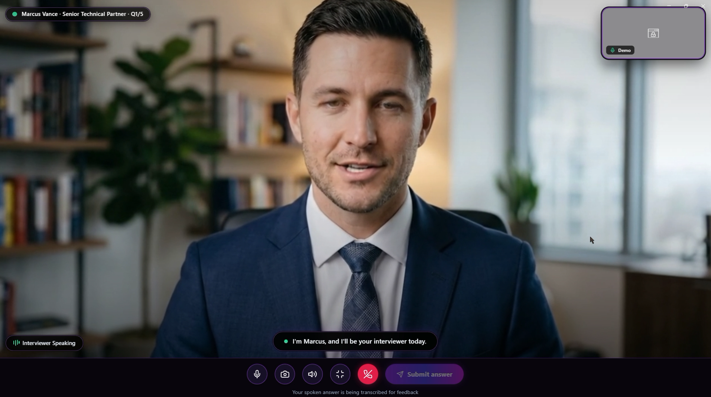
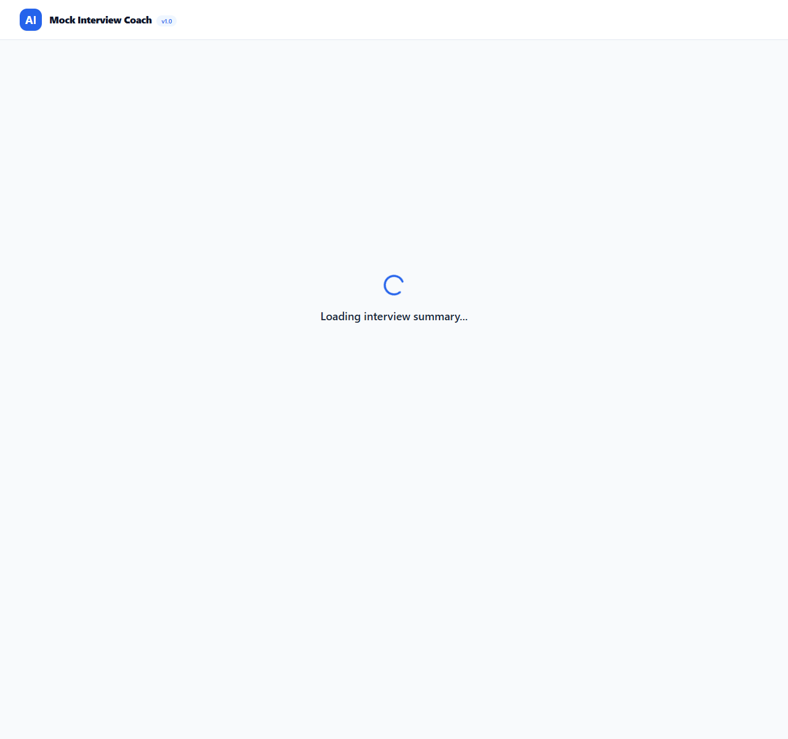
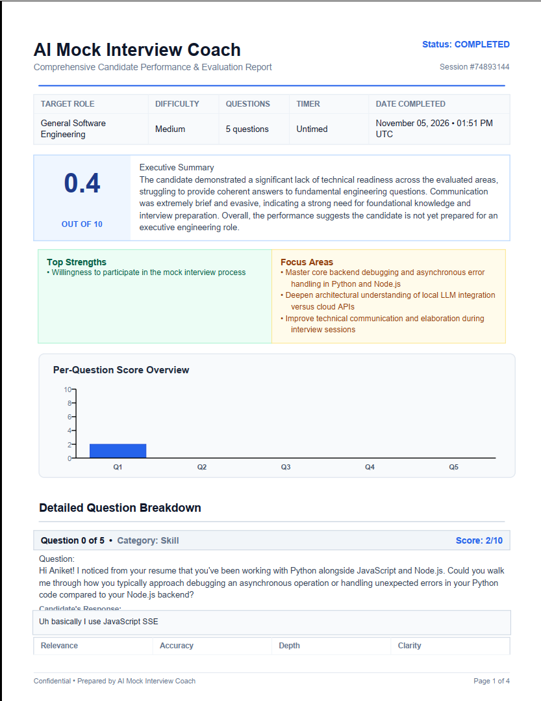

# ⚔️ Skill Leveling: AI Mock Interview Coach

> **Rise from E-Rank Weakest to S-Rank Sovereign.**  
> An AI-powered technical mock interview platform featuring gamified Hunter rank progression, resume-grounded questions, multi-modal interaction (Text, Audio, and 3D Avatar Video), multi-dimensional scoring (0–10), real-time delivery analytics, dynamic 1/3 score penalties, and downloadable publication-grade PDF evaluation reports.

---

## 📸 Screenshots Showcase

> Place your custom screenshots in the [`screenshots/`](file:///d:/Edify_project/Skill_leveling/screenshots) directory. You can capture or refresh automated screenshots at any time using:
> ```bash
> python take_screenshots.py
> ```

### 1. Hunter Association Portal & Resume Arsenal
*Upload technical resumes, parse structured skills, configure dungeon difficulty, and review score trends over time.*


*(Image location: `screenshots/dashboard.png`)*

---

### 2. Live Technical Interview Arena & Voice Analytics
*Real-time mock interview arena with server-synchronized countdown timer, continuous voice speech-to-text, WPM delivery pace, and filler-word detection.*


*(Image location: `screenshots/interview_room.png`)*

---

### 3. Photorealistic Human Interviewer & Video Practice Room
*Practice in video mode with a local camera preview and an executive photorealistic AI interviewer featuring audio-driven viseme lip synchronization, natural blinking, micro-expressions, and professional office atmosphere.*


*(Image location: `screenshots/video_interview.png` — add your video screenshot here)*

---

### 4. Dungeon Debrief & Overall Score Gauge
*Comprehensive post-session summary featuring an overall score ring gauge, top strengths, focus areas, per-question score bar charts, and expandable dimension breakdowns.*


*(Image location: `screenshots/summary_page.png`)*

---

### 5. Downloadable PDF Evaluation Report
*High-fidelity vector PDF generated via ReportLab with executive summary, metadata table, vector score chart, and detailed per-question answers and feedback.*


*(Image location: `screenshots/pdf_report.png` — add your PDF report export screenshot here)*

---

## 📚 Complete Project Documentation Suite

All system documentation, diagrams, specifications, and evaluation guides are organized in the [`docs/`](file:///d:/Edify_project/Skill_leveling/docs) folder:

| Document | Description | Link |
| :--- | :--- | :--- |
| **System Architecture** | High-level architecture, sub-system breakdown, security boundaries, and runtime topology. | [Architecture Document](docs/architecture.md) |
| **Data Flow Diagrams (DFD)** | Context Diagram (DFD Level 0), Subsystem Decomposition (DFD Level 1), and Data Dictionary. | [Data Flow Specifications](docs/data-flow.md) |
| **Database & Schema Design** | Entity-Relationship (ER) diagram, table schemas, foreign keys, indexes, and client storage. | [Schema Design Document](docs/schema-design.md) |
| **Software Requirements (SRS)** | IEEE 830-compliant functional requirements, non-functional requirements, and constraints. | [SRS Document](docs/srs.md) |
| **Evaluator & Grading Rubric Guide** | Feature verification matrix, demo script, and evaluation criteria walkthrough. | [Evaluation Guide](docs/evaluation-guide.md) |

---

## ⚡ Core Features & Capabilities

- **Authentication & User Isolation**: JWT authentication with bcrypt password hashing. Multi-tenant row-level authorization ensures users only see their own sessions and resumes.
- **Resume Ingestion & PII Redaction**: Ingests PDF and DOCX documents (up to 5 MB), extracts technical skill arsenals, and redacts emails and phone numbers before querying LLMs.
- **Candidate Name Recognition**: Intelligently identifies candidate names and strictly prevents the AI from generating questions like *"How did you implement [CandidateName]..."*.
- **Realistic Human Interviewer Persona**: Conversational, encouraging, and sharp technical interview styling rather than stiff robotic templates.
- **Multi-Modal Practice**:
  - **Text Mode**: Traditional keyboard-driven technical chat with keyboard shortcuts (`Ctrl+Enter`) and draft preservation.
  - **Audio Call Mode**: Reads questions aloud with speech synthesis, offers live audio waveforms, and transcribes voice answers.
  - **Video Call Mode**: Features an executive photorealistic human interviewer with viseme lip sync, local camera preview, and natural conversational greeting flow.
- **Gamified Hunter Progression**:
  - Level range: **0.0 to 100.0**
  - Hunter Ranks: **E-Rank** (Level 0–19), **D-Rank** (20–34), **C-Rank** (35–54), **B-Rank** (55–74), **A-Rank** (75–89), **S-Rank** (90–100).
  - Rewards and penalties: Correct answers ($\ge 7/10$) award positive levels (+6, +10, or +15); subpar answers trigger a **1/3 score penalty** (-2.0, -3.3, or -5.0).
- **Multi-Dimensional Scoring**: Evaluates Relevance, Accuracy, Depth, and Clarity on a 1–10 scale:
  $$\text{Final Score} = 0.30 \times \text{Relevance} + 0.30 \times \text{Accuracy} + 0.25 \times \text{Depth} + 0.15 \times \text{Clarity}$$
- **Fault-Tolerant UX & Zero Data Loss**: Local drafts saved in `sessionStorage` with `beforeunload` warnings. Dedicated failure retry cards allow users to retry evaluations if external APIs fail.
- **Publication-Grade PDF Export**: ReportLab vector PDF generation with custom cover banners, metadata grids, score charts, and two-pass `"Page X of Y"` footers.

---

## 🚀 Quick Start Guide

### 1. Prerequisites
- **Node.js**: 18+ and `npm`
- **Python**: 3.10+ (tested on Python 3.12 / 3.13)
- Google Chrome or Microsoft Edge (for Web Speech API features)

---

### 2. Installation & Setup

1. **Clone the repository**:
   ```bash
   git clone https://github.com/Aniket27-web/Skill_leveling.git
   cd Skill_leveling
   ```

2. **Configure Environment Variables**:
   ```bash
   # Copy backend environment template
   cp backend/.env.example backend/.env
   ```
   > By default, `LLM_PROVIDER=fake` is configured for instant offline demo and testing without requiring third-party API keys.
   > To use live LLM APIs, set:
   > - `LLM_PROVIDER=gemini` and `LLM_API_KEY=your_gemini_api_key`
   > - or `LLM_PROVIDER=openai` and `LLM_API_KEY=your_openai_api_key`
   > - or `LLM_PROVIDER=anthropic` and `LLM_API_KEY=your_anthropic_api_key`

3. **Install Dependencies**:
   ```bash
   # Root & frontend dependencies
   npm install
   npm install --prefix frontend

   # Backend Python dependencies
   cd backend
   pip install -r requirements.txt
   cd ..
   ```

4. **Seed the Database with Demo Data**:
   ```bash
   python backend/scripts/seed.py
   ```
   *Demo accounts created:*
   - **Email**: `demo@example.com` | **Password**: `password123`
   - **Email**: `jane@example.com` | **Password**: `password123`

---

### 3. Launching the Application

Run both backend and frontend concurrently with a single command from the project root:

```bash
npm run dev
```

- **Frontend Application**: `http://localhost:5173`
- **Backend API Server**: `http://localhost:8000`
- **Interactive Swagger OpenAPI Docs**: `http://localhost:8000/docs`
- **ReDoc API Documentation**: `http://localhost:8000/redoc`

---

## 🧪 Running the Test Suites

Both test suites run completely offline and verify all functional requirements:

### Backend Pytest Suite (94 Tests)
```bash
python -m pytest backend -v
```
*Covers authentication, multi-tenant isolation, resume parser, AI gateway, question deduplication, scoring formulas, session state machines, and ReportLab PDF rendering.*

### Frontend Vitest Suite (15 Tests)
```bash
npm test --prefix frontend
```
*Covers countdown timers, Web Speech recognition, feedback card states, delivery statistics, and draft preservation.*

---

## 🛡️ Technology Stack

- **Frontend**: React 18, TypeScript, Vite 5, Tailwind CSS, TanStack Query v5, Recharts, Lucide Icons, Three.js, `@react-three/fiber`, Web Speech API.
- **Backend**: FastAPI, Uvicorn, SQLAlchemy, Pydantic v2, Python-Jose (JWT), Passlib (Bcrypt), ReportLab PDF Engine, PyPDF / python-docx.
- **AI Gateway**: Unified gateway supporting Google Gemini, OpenAI, Anthropic Claude, and deterministic offline mock providers.
- **Database**: SQLite (default zero-configuration file database) / PostgreSQL.

---

## 📄 License
This project is open-source under the [MIT License](LICENSE).
