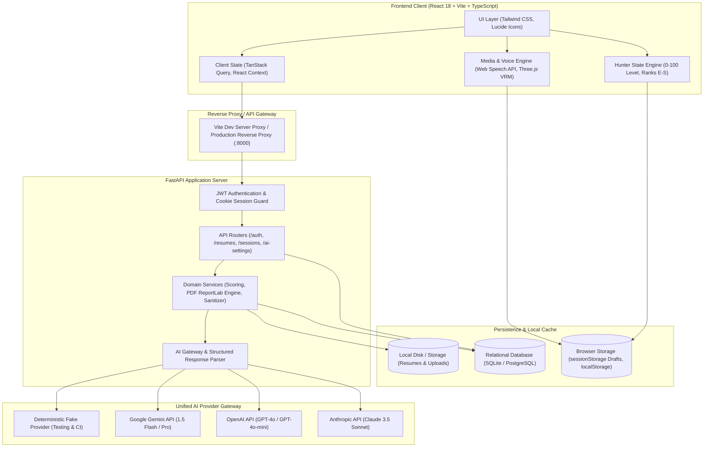
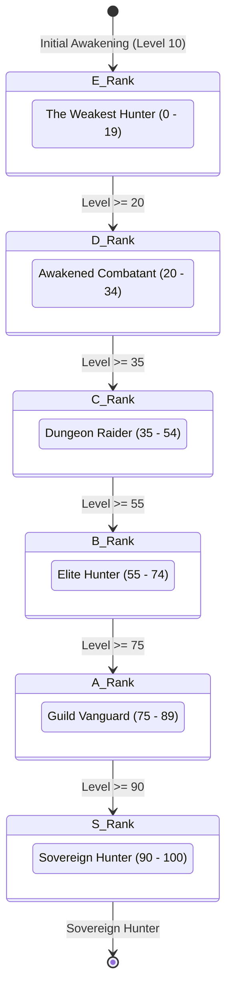

# System Architecture Document

## 1. Executive Summary

**Skill Leveling (AI Mock Interview Coach)** is a full-stack, AI-orchestrated technical interview platform designed to bridge the gap between technical preparation and interview performance. Inspired by the gamified progression mechanics of *Solo Leveling*, the platform evaluates candidates across progressive difficulty tiers (Easy Dungeons, Medium Raids, Hard Gates), calculates calibrated multi-dimensional scores (0–10), enforces strict score penalties for subpar answers, and tracks user rank progression from **E-Rank Weakest** to **S-Rank Sovereign**.

The application features multi-modal interactions including real-time text chat, audio calls with speech synthesis/recognition, a 3D avatar with viseme lip synchronization, server-authoritative timers, and high-fidelity vector PDF evaluation reports.

---

## 2. High-Level Architecture

The system follows a modern decoupled client-server architecture with an asynchronous AI gateway layer and a relational persistence core.

---

## 3. Subsystem Breakdown

### 3.1. Frontend Architecture
- **Framework & Build**: React 18, Vite 5, TypeScript.
- **Styling & Theming**: Tailwind CSS with custom Solo Leveling color palette (Mana purple `#9333ea`, dark dungeon `#07030e`, and radiant light mode).
- **Global Error Boundary**: Custom React class-based `<ErrorBoundary>` that intercepts runtime exceptions, prevents blank screen failures, and provides one-click recovery.
- **State Management**:
  - **Server State**: `@tanstack/react-query` handles caching, background polling, and optimistic mutations.
  - **Client & Theme State**: React Context API (`ThemeContext`).
  - **Session Drafts**: `sessionStorage` mirrors per-question draft text to prevent data loss on accidental tab reloads.
- **Media & Avatar Engine**:
  - **Speech Synthesis**: Web Speech `speechSynthesis` with dynamic voice selection (en-US preference) and boundary-based viseme extraction (`aa`, `ee`, `oh`, `oo`, `neutral`).
  - **Speech Recognition**: Continuous `webkitSpeechRecognition` with interim transcript streams and filler-word detection (`um`, `uh`, `like`).
  - **3D Interactive Avatar**: Three.js, `@react-three/fiber`, and `@react-three/drei` render an animated procedural or VRM avatar with real-time lip movement.

### 3.2. Backend Architecture
- **Framework**: FastAPI (Python 3.10+) running on ASGI Uvicorn.
- **ORM & Database**: SQLAlchemy with declarative models and SQLite for zero-config local development, easily swappable to PostgreSQL.
- **Authentication**: JWT authentication with SHA-256 password hashing (bcrypt/passlib) stored in secure `HttpOnly` cookies and optional `Bearer` headers.
- **Data Isolation**: Strict multi-tenant row-level authorization; users can only view, query, or delete their own resumes and sessions.

### 3.3. AI Gateway & Multi-LLM Orchestration
- **Gateway Abstraction**: `structured(task, schema, messages, ...)` enforces schema contracts across all LLMs via Pydantic v2 validation.
- **Supported Providers**:
  - **Google Gemini**: Gemini 1.5 Flash / Pro via Google GenAI SDK.
  - **OpenAI**: GPT-4o / GPT-4o-mini with structured JSON outputs.
  - **Anthropic**: Claude 3.5 Sonnet / Claude 3 Haiku via Messages API.
  - **Deterministic Fake Provider**: Offline testing provider simulating timeouts, rate limits, and golden question generation for CI/CD.
- **Prompt Isolation**: Prompts versioned in `/prompts` (`questions_v1.md`, `evaluate_v1.md`, `summary_v1.md`). Candidate names are sanitized and explicitly excluded from being mistaken for technical tools.

### 3.4. Evaluation & PDF Report Generation
- **Multi-Dimensional Scoring**: Evaluates candidate answers across 4 core axes:
  $$\text{Relevance} \times 0.30 + \text{Accuracy} \times 0.30 + \text{Depth} \times 0.25 + \text{Clarity} \times 0.15$$
- **PDF Engine**: ReportLab vector PDF generator (`backend/app/reports/render.py`) with dynamic two-pass pagination, custom color palettes, ReportLab vector bar charts, executive summaries, and per-question score breakdowns.

---

## 4. Solo Leveling Gamification Layer

### Rank & Penalty Formula
- **Easy Dungeon**: Correct ($\ge 7/10$) gives **+6.0 Level**, Subpar gives **-2.0 Level** (1/3 penalty).
- **Medium Raid**: Correct ($\ge 7/10$) gives **+10.0 Level**, Subpar gives **-3.3 Level** (1/3 penalty).
- **Hard Gate**: Correct ($\ge 7/10$) gives **+15.0 Level**, Subpar gives **-5.0 Level** (1/3 penalty).
- Dynamic browser-wide broadcast updates status bars and rank badges in real time across tabs via storage and custom events.

---

## 5. Security & Reliability Architecture

1. **PII Redaction**: Email addresses and phone numbers in resumes are regex-redacted before prompts are sent to external LLM APIs.
2. **Untrusted Data Isolation**: Resumes are encapsulated within `<resume>...</resume>` blocks with prompt injection defense instructions.
3. **Draft Preservation**: Active input text is continuously mirrored to `sessionStorage` and guarded with `beforeunload` warnings.
4. **Idempotent Evaluations**: Answer submissions verify idempotency keys to prevent duplicate scoring or charging.
5. **Zero Client-Exposed API Keys**: LLM provider credentials reside exclusively in `backend/.env`. The frontend cannot read or compromise server API keys.

