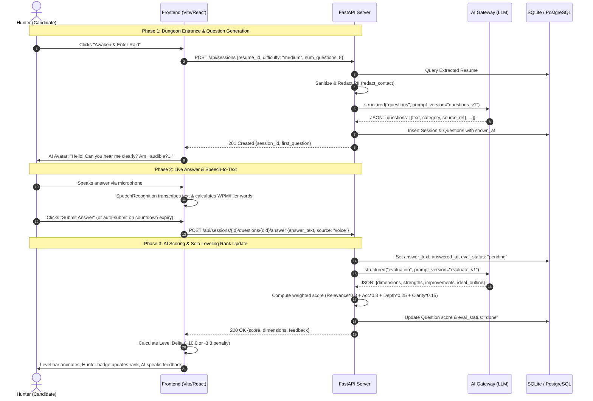

# Data Flow Diagram (DFD) Specifications

## 1. DFD Level 0: Context Diagram

The Level 0 Context Diagram establishes the boundary of the **Skill Leveling System**, showing the primary external entities and the high-level inputs and outputs exchanged with the platform.

```mermaid
flowchart TD
    Candidate(["Candidate / Hunter"])
    LLM(["External AI Provider API (Gemini / OpenAI / Claude)"])
    Storage[("File System & Database Storage")]

    Candidate -- "1. Registration & Login Credentials" --> System[["0.0 Skill Leveling Platform"]]
    Candidate -- "2. Resume Upload (PDF / DOCX)" --> System
    Candidate -- "3. Raid Setup (Difficulty, Mode, Role, Timer)" --> System
    Candidate -- "4. Spoken / Typed Answers" --> System

    System -- "1. JWT Token & Authenticated Profile" --> Candidate
    System -- "2. Structured Resume Skills Arsenal" --> Candidate
    System -- "3. Audio / Video Spoken Questions & 3D Avatar" --> Candidate
    System -- "4. Real-time Delivery Stats & 1/3 Penalties" --> Candidate
    System -- "5. Dungeon Summary & Downloadable PDF Report" --> Candidate

    System -- "Sanitized Resume Prompt & Instructions" --> LLM
    LLM -- "Structured JSON (Questions, Evals, Summaries)" --> System

    System <--> "Persisted User, Resume, Session & Answer Records" Storage
```

---

## 2. DFD Level 1: Subsystem Process Decomposition

The Level 1 Diagram decomposes the system into six primary operational processes, detailing interactions with local data stores and external APIs.

```mermaid
flowchart TB
    subgraph External["External Entities"]
        User(["Candidate / User"])
        AI["AI Provider Gateway (LLM)"]
    end

    subgraph Processes["Platform Processes"]
        P1["1.0 User Authentication & Session Security"]
        P2["2.0 Resume Parsing & PII Redaction"]
        P3["3.0 Session Orchestration & Question Generation"]
        P4["4.0 Live Interview Delivery & Speech Processing"]
        P5["5.0 AI Answer Evaluation & Rank Engine"]
        P6["6.0 Summary Analytics & PDF Report Engine"]
    end

    subgraph Stores["Data Stores"]
        D1[("DS-1 Users Store")]
        D2[("DS-2 Resumes Store")]
        D3[("DS-3 Sessions Store")]
        D4[("DS-4 Questions Store")]
        D5[("DS-5 Hunter Rank & XP State")]
    end

    %% Process 1: Auth
    User -->|"Credentials (email, password)"| P1
    P1 -->|"Create User / Read Hash"| D1
    P1 -->|"Set HttpOnly Cookie / Return User"| User

    %% Process 2: Resume
    User -->|"Upload PDF/DOCX"| P2
    P2 -->|"Extract Text, Redact PII, Match Tech"| D2
    D2 -->|"Structured Profile"| User

    %% Process 3: Session & Questions
    User -->|"Configure Session (Difficulty, Mode, Count)"| P3
    P3 -->|"Fetch Extracted Resume"| D2
    P3 -->|"Generate Questions Prompt (questions_v1)"| AI
    AI -->|"Structured Questions JSON"| P3
    P3 -->|"Store Session & Questions"| D3
    P3 -->|"Store Initial Questions"| D4
    P3 -->|"Return Session ID & First Question"| User

    %% Process 4: Live Interview
    User -->|"Voice/Typed Answer Draft"| P4
    P4 -->|"Local Draft Sync"| D5
    P4 -->|"Real-time Viseme & Audio Waveform"| User
    P4 -->|"Save Answer (eval_status: pending)"| D4

    %% Process 5: Evaluation
    P4 -->|"Trigger Evaluation"| P5
    P5 -->|"Fetch Question & Resume Context"| D4
    P5 -->|"Evaluate Prompt (evaluate_v1)"| AI
    AI -->|"4 Dimensions, Strengths, Outline"| P5
    P5 -->|"Update Score & Feedback"| D4
    P5 -->|"Calculate Rank Delta (+pts / -1/3 penalty)"| D5
    D5 -->|"Updated Hunter Level & Rank"| User
    P5 -->|"Spoken Interlocutor Feedback"| User

    %% Process 6: Summary & Report
    User -->|"Finish Interview / View Summary"| P6
    P6 -->|"Aggregate Question Scores & History"| D4
    P6 -->|"Compute Overall Score & Summary"| D3
    P6 -->|"Generate PDF ReportLab Document"| User
```



---

## 3. Data Dictionary for Primary Information Flows

| Flow Name | Source | Destination | Data Structure / Key Fields |
| :--- | :--- | :--- | :--- |
| **User Credentials** | User | `Process 1.0` | `name`, `email` (RFC 5322), `password` (min 8 chars) |
| **Auth Token** | `Process 1.0` | User | `access_token` (JWT signed with HS-256), `token_type: "bearer"` |
| **Resume Document** | User | `Process 2.0` | Multipart file stream (`.pdf` or `.docx`), max 5 MB, SHA-256 hash |
| **Extracted Profile** | `Process 2.0` | `DS-2` | `skills[]`, `technologies[]`, `projects[]`, `experience[]`, `education[]` |
| **Session Config** | User | `Process 3.0` | `difficulty` (`easy`, `medium`, `hard`), `num_questions` (3-15), `interview_mode` (`text`, `audio`, `video`), `target_role` |
| **Generated Questions**| AI Gateway | `DS-4` | Array of `{ text, category, source_ref }` |
| **Answer Submission** | User | `Process 4.0` | `answer_text` (max 4000 chars), `source` (`typed` or `voice`), `idempotency_key` (UUIDv4) |
| **Evaluation Metrics**| AI Gateway | `DS-4` | `relevance` (1-10), `accuracy` (1-10), `depth` (1-10), `clarity` (1-10), `strengths[]`, `improvements[]`, `missed_points[]`, `ideal_outline[]` |
| **Hunter Level Delta**| `Process 5.0`| `DS-5` | `isCorrect` (bool, score $\ge 7$), `delta` (+6/+10/+15 or -2.0/-3.3/-5.0), `newLevel` (0-100), `rank` (E, D, C, B, A, S) |
| **Evaluation Report** | `Process 6.0`| User | Binary PDF stream (`application/pdf`) with ReportLab vector graphics |

---

## 4. Question Generation & Evaluation Micro-Flow


