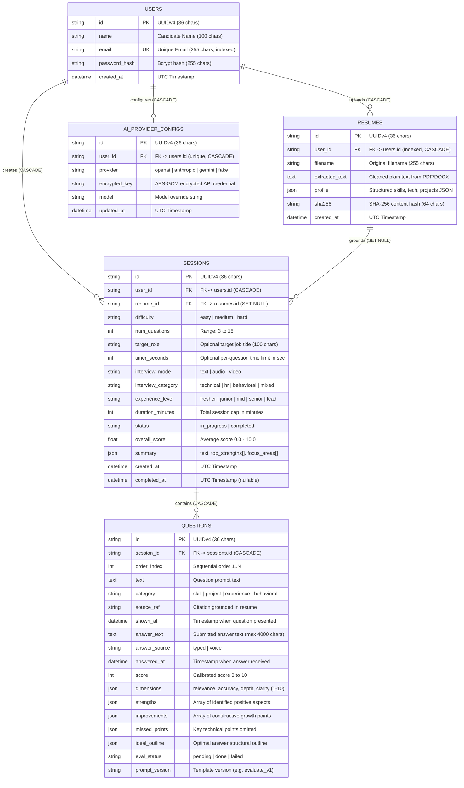

# Database & Schema Design Specification

## 1. Entity-Relationship (ER) Diagram



---

## 2. Table Specifications & Column Definitions

### 2.1. `users` Table
Stores user credentials and profile metadata.
| Column | Type | Constraints | Description |
| :--- | :--- | :--- | :--- |
| `id` | `VARCHAR(36)` | `PRIMARY KEY` | UUIDv4 string representation |
| `name` | `VARCHAR(100)` | `NOT NULL` | Hunter / Candidate full name |
| `email` | `VARCHAR(255)` | `NOT NULL, UNIQUE, INDEX` | Unique email address (lowercased) |
| `password_hash` | `VARCHAR(255)` | `NOT NULL` | Bcrypt hashed password string |
| `created_at` | `DATETIME` | `NOT NULL, DEFAULT UTC_NOW` | Account registration timestamp |

### 2.2. `resumes` Table
Stores uploaded resume documents, extracted plain text, and structured skill arsenals.
| Column | Type | Constraints | Description |
| :--- | :--- | :--- | :--- |
| `id` | `VARCHAR(36)` | `PRIMARY KEY` | UUIDv4 identifier |
| `user_id` | `VARCHAR(36)` | `NOT NULL, FOREIGN KEY -> users(id) ON DELETE CASCADE, INDEX` | Resume owner |
| `filename` | `VARCHAR(255)` | `NOT NULL` | Original uploaded document name |
| `extracted_text` | `TEXT` | `NOT NULL` | Cleaned plain text extracted from PDF/DOCX |
| `profile` | `JSON` | `NULLABLE` | Parsed skills, technologies, projects JSON |
| `sha256` | `VARCHAR(64)` | `NOT NULL` | Document content SHA-256 digest |
| `created_at` | `DATETIME` | `NOT NULL, DEFAULT UTC_NOW` | Creation timestamp |

### 2.3. `sessions` Table
Manages the lifecycle of an interview dungeon session.
| Column | Type | Constraints | Description |
| :--- | :--- | :--- | :--- |
| `id` | `VARCHAR(36)` | `PRIMARY KEY` | Unique interview session UUID |
| `user_id` | `VARCHAR(36)` | `NOT NULL, FOREIGN KEY -> users(id) ON DELETE CASCADE` | Session owner |
| `resume_id` | `VARCHAR(36)` | `NULLABLE, FOREIGN KEY -> resumes(id) ON DELETE SET NULL` | Grounding resume context |
| `difficulty` | `VARCHAR(20)` | `NOT NULL` | `easy` \| `medium` \| `hard` |
| `num_questions` | `INTEGER` | `NOT NULL` | Total questions configured (3–15) |
| `target_role` | `VARCHAR(100)` | `NULLABLE` | Optional job role (e.g. Senior Backend Dev) |
| `timer_seconds` | `INTEGER` | `NULLABLE` | Per-question countdown in seconds (e.g. 60, 120) |
| `interview_mode` | `VARCHAR(20)` | `NOT NULL, DEFAULT 'text'` | `text` \| `audio` \| `video` |
| `interview_category` | `VARCHAR(20)`| `NOT NULL, DEFAULT 'mixed'` | `technical` \| `hr` \| `behavioral` \| `mixed` |
| `experience_level` | `VARCHAR(20)` | `NOT NULL, DEFAULT 'fresher'` | `fresher` \| `junior` \| `mid` \| `senior` \| `lead` |
| `duration_minutes` | `INTEGER` | `NULLABLE` | Total duration cap in minutes (15–60) |
| `status` | `VARCHAR(20)` | `NOT NULL, DEFAULT 'in_progress'` | `in_progress` \| `completed` |
| `overall_score` | `FLOAT` | `NULLABLE` | Cumulative average score (0.0 to 10.0) |
| `summary` | `JSON` | `NULLABLE` | `{ text, top_strengths: [], focus_areas: [] }` |
| `created_at` | `DATETIME` | `NOT NULL, DEFAULT UTC_NOW` | Session initiation timestamp |
| `completed_at` | `DATETIME` | `NULLABLE` | Completion timestamp |

**Indexes**:
- `ix_sessions_user_id_created_at`: Composite index on `(user_id, created_at DESC)` for efficient history lookups and dashboard progress charts.

### 2.4. `questions` Table
Stores individual interview questions, candidate responses, dimensional scores, and AI feedback.
| Column | Type | Constraints | Description |
| :--- | :--- | :--- | :--- |
| `id` | `VARCHAR(36)` | `PRIMARY KEY` | Unique question UUID |
| `session_id` | `VARCHAR(36)` | `NOT NULL, FOREIGN KEY -> sessions(id) ON DELETE CASCADE` | Associated session |
| `order_index` | `INTEGER` | `NOT NULL` | Question sequence order (1, 2, 3...) |
| `text` | `TEXT` | `NOT NULL` | Formulated interviewer question prompt |
| `category` | `VARCHAR(50)` | `NOT NULL` | `skill` \| `project` \| `experience` \| `behavioral` |
| `source_ref` | `VARCHAR(255)` | `NULLABLE` | Citation string referencing specific resume section |
| `shown_at` | `DATETIME` | `NULLABLE` | Timestamp when question presented to candidate |
| `answer_text` | `TEXT` | `NULLABLE` | Candidate's submitted answer (max 4000 characters) |
| `answer_source` | `VARCHAR(20)` | `NULLABLE` | Input method (`typed` or `voice`) |
| `answered_at` | `DATETIME` | `NULLABLE` | Timestamp when answer was submitted |
| `score` | `INTEGER` | `NULLABLE` | Rounded final question score (0 to 10) |
| `dimensions` | `JSON` | `NULLABLE` | `{ relevance: int, accuracy: int, depth: int, clarity: int }` |
| `strengths` | `JSON` | `NOT NULL, DEFAULT []` | Specific candidate achievements in answer |
| `improvements` | `JSON` | `NOT NULL, DEFAULT []` | Specific suggestions for missing depth |
| `missed_points` | `JSON` | `NOT NULL, DEFAULT []` | Omitted critical concepts |
| `ideal_outline` | `JSON` | `NOT NULL, DEFAULT []` | Best-practice answer structural outline |
| `eval_status` | `VARCHAR(20)` | `NOT NULL, DEFAULT 'pending'` | `pending` \| `done` \| `failed` |
| `prompt_version` | `VARCHAR(50)` | `NULLABLE` | Prompt template version (e.g. `questions_v1`) |

**Indexes**:
- `ix_questions_session_id_order_index`: Composite index on `(session_id, order_index)` for sequential retrieval and ordering.

---

## 3. Client-Side Browser Storage Schema

### 3.1. `localStorage` Keys
- **`skill_leveling_hunter_stats`**: Persists the Hunter leveling profile:
  ```json
  {
    "level": 42.5,
    "exp": 180,
    "totalAnswered": 12,
    "totalCorrect": 9,
    "totalPenalties": 3,
    "highestRank": "C"
  }
  ```
- **`interview_voice_name`**: Stores the user's preferred speech synthesis voice name (e.g., `Google US English`).
- **`skill_leveling_theme`**: Stores selected UI theme (`dark` or `light`).

### 3.2. `sessionStorage` Keys
- **`draft_answer_{sessionId}_{questionId}`**: Live text mirroring for unsubmitted drafts. Automatically cleared upon successful submission or session exit.

